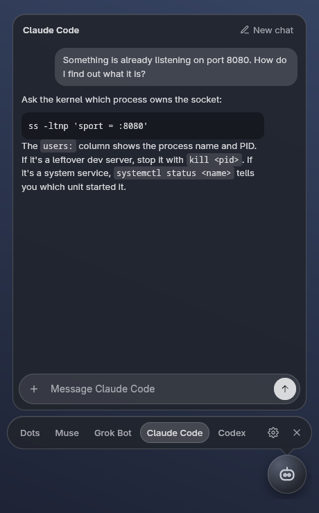
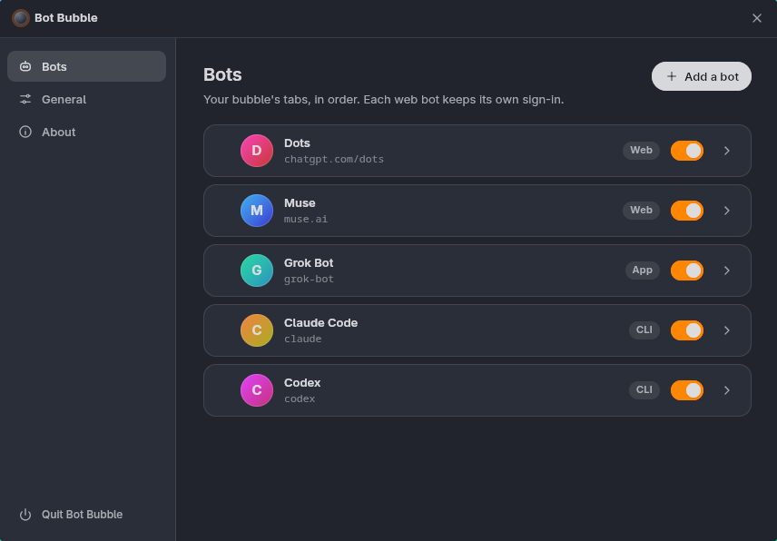

# Bot Bubble

[](https://github.com/sponsors/VibeCodyH) [](https://ko-fi.com/vibecody)

A small floating dot for your AI bots. Click it and a chat bubble opens with the real bot, your real threads, and the bot's own input bar. Drag it anywhere, lock it in place, and see an unread badge when a bot replies while the bubble is closed.

It works with the bot products themselves, not their APIs, so it runs on the subscriptions you already pay for. Works with Dots, Muse, Grok Bot, ChatGPT, Claude, Gemini and other chat sites, plus agent CLIs like Claude Code and Codex.

<p>
  
  
</p>

| Type | What the bubble shows | Examples |
|------|-----------------------|----------|
| `web` | The bot's own web app, signed in as you, in a persistent session | Dots, Muse |
| `app` | A button that opens the vendor's desktop app (for bots with no web client) | Grok Bot |
| `cli` | A chat view over an agent CLI on your subscription login | Claude Code, Codex, Grok Build, Muse Code |

## Install

**Prebuilt AppImage (Linux x86_64):** [buy it here](https://vibecodyh.lemonsqueezy.com/checkout/buy/f97e0430-9ffa-461f-84d1-cf0a3ec2e1b8) for $2.99, or pay what you want from $1.99. It's the same code as this repo, with no license key or DRM. Buying the build is a way to support the project if you'd rather not build it yourself.

```bash
chmod +x Bot-Bubble-*.AppImage
./Bot-Bubble-*.AppImage
```

If your distro has no FUSE, run it with `--appimage-extract-and-run`.

**From source (free):** needs Node.js and npm.

```bash
git clone https://github.com/VibeCodyH/bot-bubble.git
cd bot-bubble
npm install
./bin/bot-bubble
```

To build the AppImage yourself, run `npm run dist`. It lands in `dist/`. macOS and Windows builds are covered under [Platforms](#platforms).

## Use

- **Click** the dot to open or close the bubble. **Esc** closes it.
- **Drag** the dot to move it. **Right-click** it for a menu: switch bots, New chat or Reload, Lock position, Settings, Quit.
- Run the app again while it's running to toggle the bubble, so you can bind it to a hotkey. `--settings` opens Settings, and `--open=<bot id>` opens the bubble on that bot.
- The position, lock state, active bot, and CLI threads are saved in `~/.local/share/bot-bubble/state.json`.

## Configure

Open **Settings** from the gear in the bot bar, the right-click menu, or `--settings`. Add, remove, reorder and rename bots, sign a web bot out, or clear a CLI conversation. Under **General**, pick a **Default bot** the bubble always opens on, or hide the **bot bar** so the dot opens straight into that bot. Changes apply immediately.

**Avatars:** a web bot's dot shows the bot's own avatar, animation included, copied from its page in your signed-in session. Change the avatar in the bot and the dot follows. That works for round video or image avatars and for sprite-sheet pets: Bot Bubble animates the sheet itself, so the pet idles, blinks, and turns its head toward your cursor. Any bot can use a custom image instead.

Everything is stored in `~/.config/bot-bubble/config.json` if you'd rather edit by hand. Each bot needs an `id` (letters, digits, `-` or `_`), a `label` and a `type`:

```json
{
  "active": "dots",
  "providers": [
    { "id": "dots", "label": "Dots", "type": "web", "url": "https://chatgpt.com/dots" },
    { "id": "muse", "label": "Muse", "type": "web", "url": "https://muse.ai" },
    { "id": "grokbot", "label": "Grok Bot", "type": "app", "command": ["grok-bot"],
      "avatar": ["/opt/Grok Bot/resources/icon.png"] },
    { "id": "claude", "label": "Claude Code", "type": "cli", "agent": "claude" },
    { "id": "codex", "label": "Codex", "type": "cli", "agent": "codex" },
    { "id": "grok", "label": "Grok Build", "type": "cli", "agent": "grok" },
    { "id": "musecode", "label": "Muse Code", "type": "cli", "agent": "muse" }
  ]
}
```

`avatar` is optional and takes a list of image paths. The first one that exists is used.

## How it works

- **Web bots** each get their own persistent Chromium session, so you sign in once per bot. They stay loaded in the background so a reply can light the badge before you open them. The badge comes from the page's own web notifications or from a reply streaming into a hidden page. Nothing is site-specific. Microphone and notification permissions are granted only to the bot's own site.
- **Real-browser mode** (per web bot, in Settings) is for bots whose sign-in refuses embedded browsers. Google sign-in does this on purpose, so an account that only signs in with Google can't log in inside the bubble. The bot then runs in a real Brave, Chromium or Chrome app window with its own profile. With Brave or Chromium, a small extension in that private profile reports replies and the bot's avatar back to Bot Bubble over a token-protected loopback connection, so unread badges and avatars still work. Branded Chrome refuses command-line extensions, so it's the fallback: sign-in works, no extras.
- **CLI agents** run headless in an empty folder under `~/.local/share/bot-bubble/workspace/`, and none of them can write. Claude Code and Grok Build get no tools at all. Codex runs in its read-only sandbox and Muse Code with writes disabled, so those two can still read files on disk. Images are sent as images. Other text files are inlined up to 100 KB.
- **Hyprland:** Wayland doesn't let a window position or pin itself, so on Hyprland Bot Bubble asks the compositor directly over its IPC socket. It registers a runtime window rule (float, pin, no border, no blur) and moves itself with dispatchers. Nothing is written to your Hyprland config, and the rule disappears on a Hyprland reload.

## Platforms

Developed on Fedora 44 with Hyprland 0.56 (Lua config). Reports and fixes for other setups are welcome.

| Platform | State |
|----------|-------|
| Hyprland 0.55+ | Full support, including real-browser window parking. |
| macOS 26 (Apple silicon) | Checked: the dot stays on top, the bubble opens, dragging and web bots work. |
| Windows 10 | Checked: the dot stays on top, the bubble opens, dragging and web bots work. |
| Older Hyprland, X11 | The dot uses Electron's own always-on-top and positioning. Untested. |
| GNOME, KDE and other Wayland compositors | The dot shows, but the compositor decides where. Position isn't restored. Untested. |

macOS and Windows builds aren't signed yet, so Gatekeeper and SmartScreen will warn on first launch. Build them with `npm run dist:mac` on a Mac or `npm run dist:win` on Windows.

Real-browser mode looks for Brave, Chromium or Chrome on your `PATH` on Linux, and in the standard install folders on macOS and Windows (untested on macOS). Parking that window over the bubble, pinning it, and hiding it when the bubble closes only works on Hyprland. Elsewhere it opens in its own browser window over the bubble, but Bot Bubble can't pin that window or hide it when the bubble closes.

## Status

v0.1. Dictation and voice come from each web bot's own input bar. CLI agents have none yet.

Grok Bot has no web client or API, so for now its tab opens the app.

## Support

Bot Bubble is free software. If it's useful to you:

- [Sponsor on GitHub](https://github.com/sponsors/VibeCodyH)
- [Leave a tip on Ko-fi](https://ko-fi.com/vibecody)
- [Buy the prebuilt AppImage](https://vibecodyh.lemonsqueezy.com/checkout/buy/f97e0430-9ffa-461f-84d1-cf0a3ec2e1b8)

## License

[GPL-3.0](LICENSE). You can use, change and share it. If you distribute a modified version, you have to share its source under the same license.

## Not affiliated

Bot Bubble is an independent project. It isn't made, endorsed or supported by OpenAI, Meta, xAI, Anthropic, Google or any other company whose bots it works with. Product names belong to their owners and are used only to say what Bot Bubble works with.
